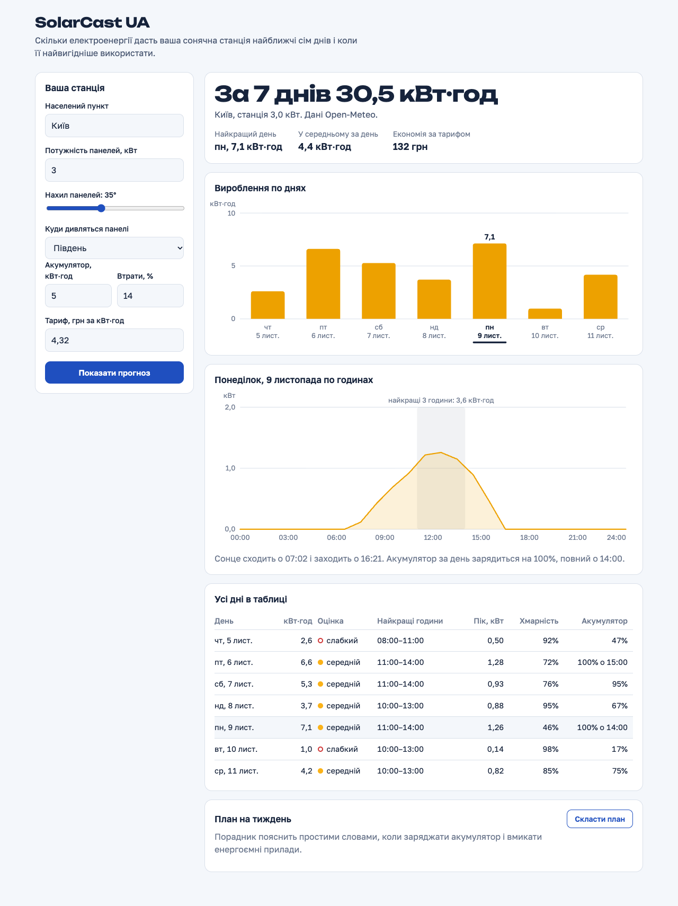
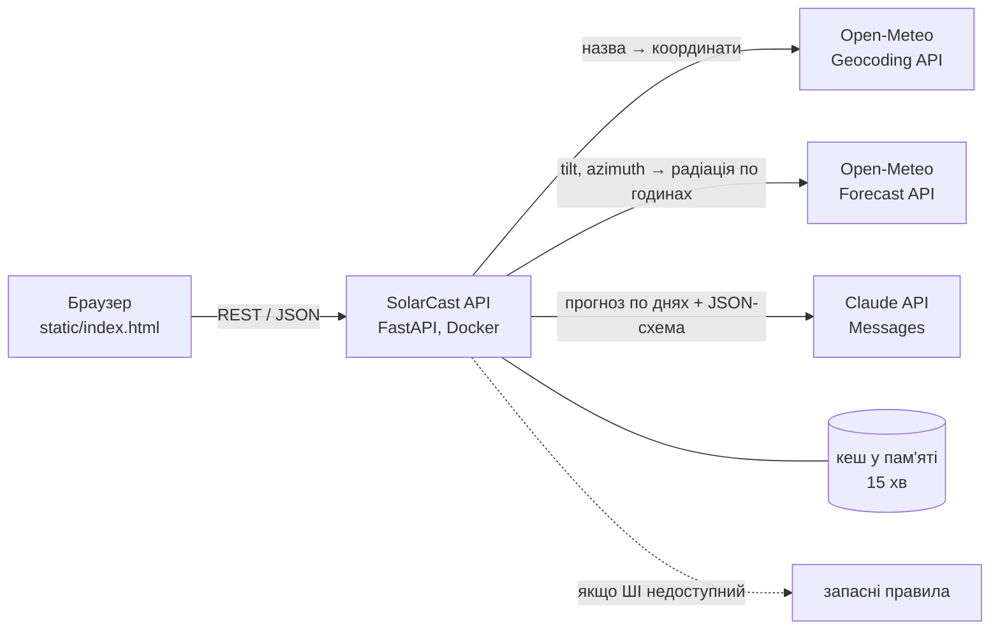

# SolarCast UA

Прогноз вироблення домашньої сонячної станції на 7 днів і план, коли цю енергію
найвигідніше використати. Лабораторна робота № 2 з дисципліни «Хмарні обчислення»:
PoC-проєкт з інтеграцією хмарних API та API моделі штучного інтелекту.



Демо-відео: [`docs/demo.mp4`](docs/demo.mp4) (50 с), план у ньому складає Claude.

## Суть проєкту

Власник невеликої сонячної станції (панелі на даху чи балконі плюс акумулятор або
зарядна станція) щодня вирішує одне й те саме: чи вистачить сонця, коли заряджати
акумулятор і коли вмикати пральну машину чи бойлер. SolarCast UA відповідає на це
за параметрами саме його станції:

- скільки кВт·год вона дасть кожного з наступних семи днів і по годинах;
- які три години поспіль найсильніші кожного дня;
- чи зарядиться акумулятор повністю і о котрій;
- скільки це заощадить за тарифом;
- план на тиждень простими словами, який складає модель Claude.

Де це можна використовувати: домогосподарства з власною генерацією під час
відключень, ОСББ і невеликі бізнеси з дахом під панелі, монтажники (оцінка
виробітку на об'єкті ще до встановлення), планувальники «розумного дому», які
вмикають навантаження за розкладом.

## Які API використовуються

| API | Для чого | Автентифікація |
|---|---|---|
| [Open-Meteo Geocoding API](https://open-meteo.com/en/docs/geocoding-api) | назва населеного пункту українською → координати і часовий пояс | не потрібна |
| [Open-Meteo Forecast API](https://open-meteo.com/en/docs) | погодинна сонячна радіація на площину панелі (`global_tilted_irradiance` з параметрами `tilt` і `azimuth`), температура, хмарність, схід і захід сонця | не потрібна |
| [Claude API, Messages](https://platform.claude.com/docs) (модель `claude-opus-5-5`) | план на тиждень природною мовою у вигляді структурованої відповіді | ключ `ANTHROPIC_API_KEY` |

Власний REST API сервісу:

| Метод | Що робить |
|---|---|
| `GET /api/geocode?q=Київ` | пошук населеного пункту |
| `GET /api/forecast?lat=..&lon=..&kwp=3&tilt=35&azimuth=0&losses=14&battery_kwh=5&tariff=4.32` | прогноз вироблення: по годинах, по днях, підсумки |
| `POST /api/advice` | план на тиждень: Claude або запасні правила. У тілі лише параметри станції, прогноз сервер рахує сам |
| `GET /api/health` | стан сервісу і кешу |

Інтерактивна документація власного API генерується автоматично: `/docs` (OpenAPI).

## Як взаємодіють сервіси



1. Браузер шукає населений пункт: `GET /api/geocode` → Open-Meteo Geocoding.
2. Браузер просить прогноз: `GET /api/forecast`. Сервіс бере в Open-Meteo Forecast
   радіацію вже перераховану на нахил та орієнтацію панелей, а далі сам рахує
   потужність за моделлю з `app/solar.py`:
   `P = P_пік · GTI/1000 · (1 − втрати) · (1 − 0,004 · (T_елемента − 25))`.
   Відповіді Open-Meteo кешуються на 15 хвилин.
3. Браузер просить план: `POST /api/advice` з тими самими параметрами станції. Сервіс
   сам перераховує прогноз (Open-Meteo відповідає з кешу) і надсилає підсумки по днях,
   без погодинних даних, у Claude API разом зі схемою відповіді (Pydantic-модель
   `Advice`). Тому відповідь завжди має ту саму структуру і не потребує розбору тексту,
   а модель отримує лише числа, які порахував сервіс.
4. Якщо Claude API недоступний (немає ключа, ліміт, мережа, відмова моделі), ту
   саму структуру заповнюють детерміновані правила, а інтерфейс чесно показує джерело.

Ключ Claude API живе лише на сервері: браузер звертається тільки до власного API.

Безпека: вхідні параметри перевіряються суворою схемою (зайві поля відхиляються),
назва місця очищується до звичайного тексту, кеш Open-Meteo обмежений 512 записами,
тексти винятків не потрапляють у відповіді, контейнер працює від непривілейованого
користувача.

## Запуск

```bash
git clone https://github.com/AIAvenger1/solarcast-ua.git && cd solarcast-ua

# локально (потрібен uv)
cp .env.example .env            # впишіть ANTHROPIC_API_KEY, якщо хочете ШІ-план
uv sync
uv run --env-file .env uvicorn app.main:app --port 8765
open http://127.0.0.1:8765

# або в Docker
docker build -t solarcast-ua .
docker run --rm -p 127.0.0.1:8080:8080 --env-file .env solarcast-ua

# тести (Open-Meteo і Claude підмінені, мережа не потрібна)
uv run pytest

# перезаписати демо-відео і скриншоти (потрібні Google Chrome та ffmpeg)
uv run python scripts/record_demo.py
```

## Розгортання на хмарній VM (Hetzner Cloud)

Сервіс розгорнуто на VM Hetzner Cloud (CX23, Гельсінкі, Ubuntu 26.04):
https://solarcast.2-29-167-169.sslip.io

Потрібна VM з Docker, відкритими портами 80 і 443 та доступом по SSH:

```bash
./deploy/deploy.sh <ssh-хост>                          # https://solarcast.<ip>.sslip.io, без власного домену
./deploy/deploy.sh <ssh-хост> solarcast.example.com    # власний домен (A-запис на адресу VM)
```

Скрипт копіює код і `.env` у `/opt/solarcast-ua`, збирає образ на сервері та запускає два
контейнери: застосунок і Caddy. Caddy сам отримує HTTPS-сертифікат і єдиний видимий з
інтернету; застосунок слухає лише внутрішню мережу, працює без привілеїв, з файловою
системою тільки для читання. Ключ лежить у `.env` з правами 600. На сервері ввімкнено
фаєрвол (22, 80, 443) і автоматичні оновлення безпеки.

Зупинити: `ssh <ssh-хост> 'cd /opt/solarcast-ua && docker compose down'`.

## Альтернатива: Google Cloud Run

Сервіс не зберігає стану, тому підходить для Cloud Run як є:

```bash
gcloud run deploy solarcast-ua --source . --region europe-central2 \
  --allow-unauthenticated --set-secrets ANTHROPIC_API_KEY=anthropic-key:latest
```

Ключ варто покласти в Secret Manager (`gcloud secrets create anthropic-key --data-file=-`),
а не в змінні середовища відкритим текстом. Розгортання в цьому репозиторії описане,
але не виконувалось.

## Структура

```
app/main.py        HTTP API і роздача фронтенду
app/openmeteo.py   клієнт Open-Meteo з кешем
app/solar.py       модель вироблення (чисті функції)
app/advisor.py     Claude API + запасні правила
app/limits.py      ліміти запитів і денний бюджет моделі
static/index.html  інтерфейс (HTML, CSS, JS без збірки)
tests/             34 тести моделі, API та лімітів
scripts/           запис демо
```

## Обмеження

- Це оцінка, а не гарантія: модель не враховує затінення, сніг на панелях і
  обмеження інвертора окремо від панелей.
- Тариф за замовчуванням (4,32 грн за кВт·год) можна змінити у формі.
- Дані Open-Meteo безкоштовні для некомерційного використання.
- Один план від Claude коштує близько 5 центів (приблизно 4 тис. вхідних і 1,4 тис. вихідних
  токенів на `claude-opus-5-5`); витрату кожного виклику сервер пише в журнал.
- `/api/advice` обмежено шістьма запитами за 10 хвилин з однієї адреси, а виклики моделі
  мають дві денні стелі: на весь сервіс (`SOLARCAST_AI_DAILY_CALLS`, типово 300) і на одного
  клієнта (`SOLARCAST_AI_DAILY_CALLS_PER_CLIENT`, типово 20). Таблиці лімітів жорстко
  обмежені за розміром. Лічильники живуть у пам'яті одного процесу, а клієнта визначає
  лише адреса: для відкритого розгортання потрібні автентифікація та спільне сховище.
- Презентація: https://claude.ai/artifact/KsfwgELBLZt4BgMpFugTN1 (приватна, доки нею не поділитися).
